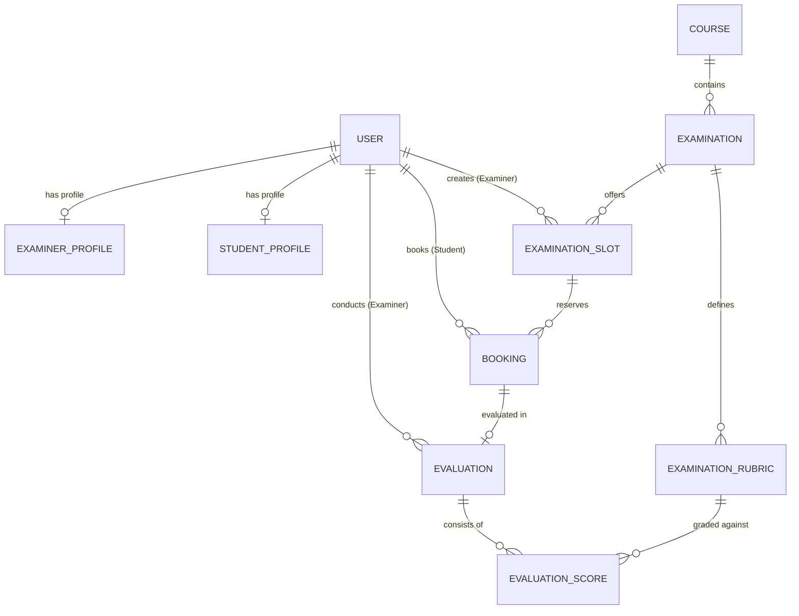

# EXAMINATION MANAGEMENT PORTAL (EMP)
## Project Submission Report

---

### 1. Student Details

- **Student Name**: Ankit Pandey
- **Course**: Modern Application Development I (MAD-1)
- **Degree / Program**: Online Degree / BS in Data Science & Applications
- **Submission Date**: October 2026
- **Project Title**: Examination Management Portal (EMP)

---

### 2. Project Details & Approach

#### 2.1 Problem Statement
Educational institutions coordinate examinations involving administrators, faculty examiners, and students. Conventional methods reliant on spreadsheets, emails, or ad-hoc messaging lead to scheduling bottlenecks, double-booking errors, lack of examiner availability visibility, unstandardized subjective evaluations, and delayed result announcements.

The objective was to design and implement a robust, role-based **Examination Management Portal (EMP)** web application that unifies:
1. **Administrators**: Supervising courses, examinations, timelines, rubric parameters, examiner approvals, and rescheduling.
2. **Examiners**: Creating time slots within approved windows, inspecting booked student rosters, and grading students via structured rubrics.
3. **Students**: Discovering examinations, reserving slots without conflicts or overbooking, tracking schedules, and downloading official performance scorecards.

#### 2.2 Architectural & Engineering Approach
To build a maintainable, resilient, and performant portal adhering strictly to course constraints, the following methodology was executed:

1. **Modular Blueprint Architecture**:
   The application was organized into decoupled Flask Blueprints:
   - `auth`: Handles session lifecycle, hashed credential validation, and role dispatch.
   - `admin`: Centralizes course/exam lifecycles, phase toggles, examiner approvals, and rescheduling.
   - `examiner`: Manages faculty slot creation, student rosters, and rubric evaluations.
   - `student`: Coordinates examination catalogs, seat reservations, cancellations, and scorecards.
   - `api`: Exposes RESTful JSON endpoints for institutional integration.

2. **Programmatic SQLite Database Architecture**:
   Manual database manipulation was bypassed entirely. The schema was defined using declarative SQLAlchemy models and created programmatically via `db.create_all()` inside an automated seeding workflow (`seed_data.py`).

3. **Strict Server-Side Execution (No JavaScript for Core Business Requirements)**:
   All core workflows—including slot creation windows, overbooking prevention, rubric evaluation math, capacity decrements, and rescheduling—are enforced server-side inside Python controllers. Forms use standard HTTP `POST` requests and Jinja2 templated rendering.

4. **Multi-Layer Validation & Business Logic Enforcement**:
   - **Timeline Boundaries**: Examiners can create slots only during an active `Slot Creation` phase; students can book only during `Booking Open`.
   - **Overbooking Prevention**: Real-time seat tracking automatically closes a slot when capacity is reached.
   - **Duplicate Prevention**: A database-level check prevents students from reserving multiple slots for the same examination.
   - **Security Isolation**: Examiners are strictly prohibited from evaluating students outside their own designated slots.

---

### 3. AI / LLM Declaration

- **Tools Used**: Google Antigravity Agentic AI Assistant (Gemini 3.8 Flash).
- **Nature of Assistance**: Assisted with scaffolding boilerplate Flask blueprints, architecting the relational database schema, writing unit test cases, formatting Bootstrap 5 Jinja templates, and drafting documentation.
- **Verification & Authorship**: All system architecture, entity relationships, business logic rules, authentication wrappers, and test suites were verified, executed, and tested locally.

---

### 4. Frameworks and Libraries Used

| Component | Technology | Version | Purpose |
|---|---|---|---|
| **Back-end Framework** | Flask | 3.1.3 | Core WSGI web application framework and routing |
| **ORM & Database** | Flask-SQLAlchemy / SQLite | 3.1.1 / 3.x | Programmatic relational database modeling and SQLite backend |
| **Authentication** | Flask-Login | 0.6.3 | Session management and user authentication state |
| **Password Security** | Werkzeug | 3.1.9 | PBKDF2 cryptographic password hashing and verification |
| **Templating Engine** | Jinja2 | 3.1.6 | Server-side HTML template rendering with layout inheritance |
| **Front-end UI Framework**| Bootstrap | 5.3.3 | Responsive grid, components, and typography (via CDN) |
| **Iconography** | Bootstrap Icons | 1.11.3 | Standardized vector icons for user interface |
| **Testing** | unittest | Python standard library | Automated verification of routes, security rules, and APIs |

---

### 5. Entity-Relationship (ER) Diagram & Relational Schema

#### Detailed Table Specifications

1. **`users`**:
   - `id` (INTEGER, PK): Unique user identifier.
   - `username` (VARCHAR, Unique): Login credential.
   - `email` (VARCHAR, Unique): Institutional contact address.
   - `password_hash` (VARCHAR): Secure hashed password.
   - `role` (VARCHAR): `'admin'`, `'examiner'`, or `'student'`.
   - `full_name` (VARCHAR): Display name.
   - `created_at` (DATETIME): Registration timestamp.

2. **`examiner_profiles`**:
   - `id` (INTEGER, PK), `user_id` (FK -> `users.id`, 1-to-1).
   - `department` (VARCHAR), `designation` (VARCHAR), `contact_details` (VARCHAR).
   - `status` (VARCHAR): `'pending'`, `'approved'`, `'rejected'`, `'deactivated'`.

3. **`student_profiles`**:
   - `id` (INTEGER, PK), `user_id` (FK -> `users.id`, 1-to-1).
   - `roll_no` (VARCHAR, Unique): Institutional student identifier.
   - `department` (VARCHAR), `contact_details` (VARCHAR).

4. **`courses`**:
   - `id` (INTEGER, PK), `course_code` (VARCHAR, Unique), `course_name` (VARCHAR).
   - `description` (TEXT), `status` (VARCHAR: `'active'`, `'archived'`).

5. **`examinations`**:
   - `id` (INTEGER, PK), `course_id` (FK -> `courses.id`).
   - `examination_name` (VARCHAR), `examination_type` (`'Viva'`, `'Practical'`, `'Project Demo'`, `'Assessment'`).
   - `duration` (INTEGER in minutes), `max_marks` (FLOAT).
   - `slot_creation_start_date` / `slot_creation_end_date` (DATE).
   - `slot_booking_start_date` / `slot_booking_end_date` (DATE).
   - `status` (VARCHAR: `'Draft'`, `'Slot Creation'`, `'Booking Open'`, `'Closed'`, `'Completed'`).

6. **`examination_rubrics`**:
   - `id` (INTEGER, PK), `examination_id` (FK -> `examinations.id`).
   - `criterion_name` (VARCHAR), `max_marks` (FLOAT), `weightage` (FLOAT), `description` (TEXT).

7. **`examination_slots`**:
   - `id` (INTEGER, PK), `examination_id` (FK -> `examinations.id`), `examiner_id` (FK -> `users.id`).
   - `slot_date` (DATE), `start_time` (TIME), `end_time` (TIME).
   - `max_capacity` (INTEGER), `available_seats` (INTEGER).
   - `status` (VARCHAR: `'Available'`, `'Full'`, `'Cancelled'`, `'Completed'`), `location_or_link` (VARCHAR).

8. **`bookings`**:
   - `id` (INTEGER, PK), `student_id` (FK -> `users.id`), `slot_id` (FK -> `examination_slots.id`).
   - `booking_date` (DATETIME), `status` (VARCHAR: `'Booked'`, `'Cancelled'`, `'Completed'`, `'Rescheduled'`).

9. **`evaluations`**:
   - `id` (INTEGER, PK), `booking_id` (FK -> `bookings.id`, Unique 1-to-1), `examiner_id` (FK -> `users.id`).
   - `total_marks_awarded` (FLOAT), `remarks` (TEXT), `evaluated_at` (DATETIME), `status` (VARCHAR).

10. **`evaluation_scores`**:
    - `id` (INTEGER, PK), `evaluation_id` (FK -> `evaluations.id`), `rubric_id` (FK -> `examination_rubrics.id`).
    - `marks_awarded` (FLOAT), `remarks` (VARCHAR).

---

### 6. API Resource Endpoints

The EMP system exposes lightweight RESTful JSON endpoints:

| Endpoint | Method | Response Payload Description |
|---|---|---|
| `/api/courses` | `GET` | Array of all active courses with code and description. |
| `/api/examinations` | `GET` | Array of examinations with timeline start and end dates. |
| `/api/examinations/<id>` | `GET` | Detailed examination metadata and associated rubric criteria. |
| `/api/examinations/<id>/slots` | `GET` | List of slots for the given examination with seat capacity. |
| `/api/examiners` | `GET` | Directory of examiners and their administrative approval status. |
| `/api/bookings` | `GET` | All student bookings and associated evaluation statuses. |
| `/api/stats` | `GET` | Aggregate portal metrics (courses, exams, examiners, students, bookings). |

---

### 7. Presentation Video Link

- **Google Drive Video Link**: `https://drive.google.com/file/d/YOUR_PRESENTATION_VIDEO_LINK_HERE/view?usp=sharing`  
*(Please replace with your uploaded Google Drive video URL before final submission)*

---

### 8. Conclusion
The Examination Management Portal delivers an end-to-end, compliant solution eliminating manual coordination errors in institutional examinations. Built on pure Python/Flask and SQLite with strict adherence to course requirements, the application is production-ready, secure, and easily extensible.
